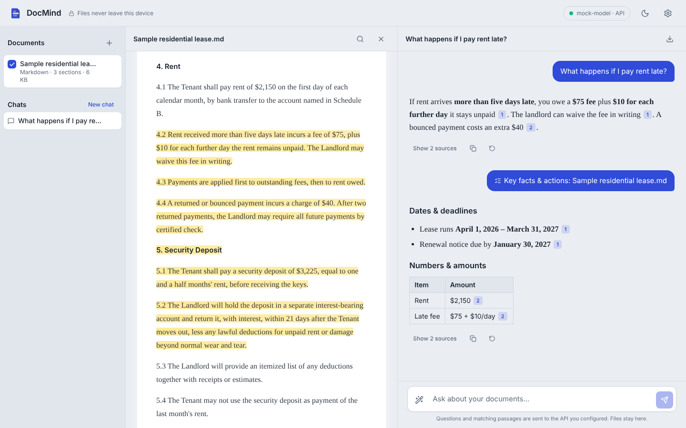
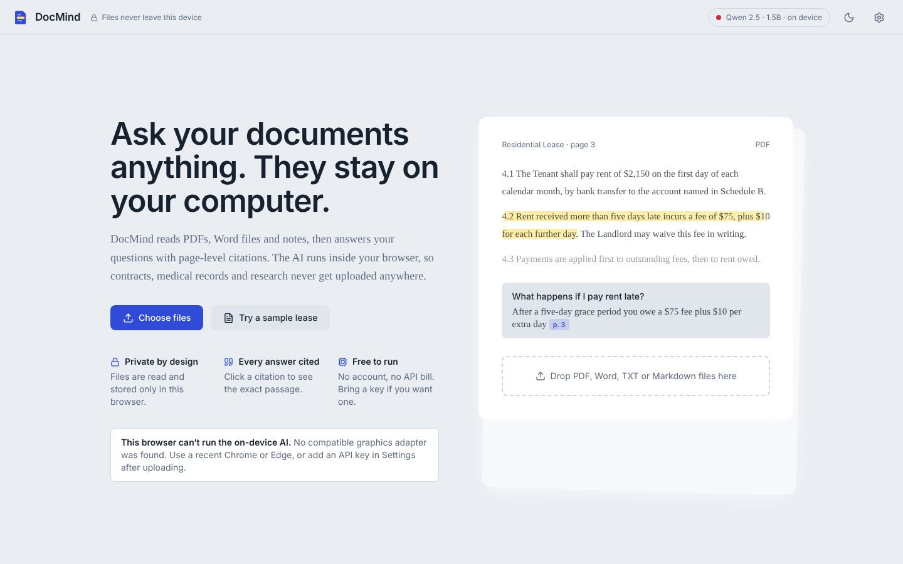
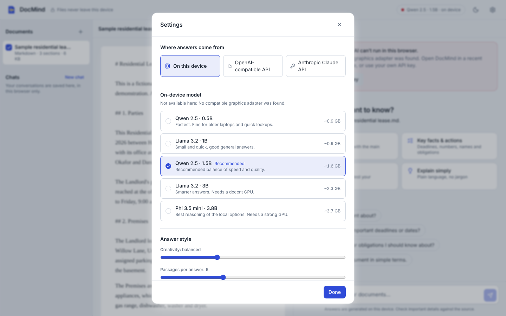
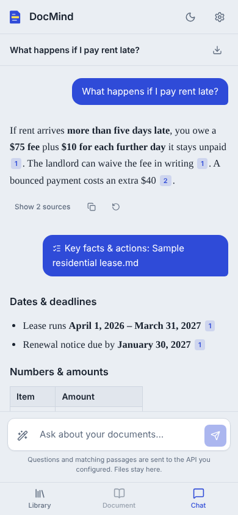
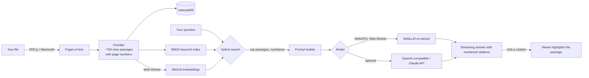

# DocMind

**Chat with your documents using AI that runs entirely in your browser.** Drop in PDFs, Word files or notes, ask questions, and get answers with clickable citations to the exact passage. Your files never leave your device: no server, no database, no account.

<!-- Replace YOUR-USERNAME after you publish -->
**[Live demo →](https://juburaz-dot.github.io/docmind/)**



---

## Why DocMind?

Most "chat with your PDF" tools upload your files to someone else's server. That is a problem for contracts, medical records, financial statements, and unpublished research. DocMind does all the work locally:

- The documents are parsed in the browser.
- Search runs in the browser.
- The language model runs **on your GPU through WebGPU**.

After the first visit it even works offline.

## Features

### Ask and verify
- **Chat with one or many documents**: PDF, Word (.docx), TXT and Markdown, several at once.
- **Streaming answers** that appear word by word.
- **Citations on every claim.** Click a citation and the document viewer scrolls to the passage and highlights it.
- **Include or leave out documents** with a checkbox to control what the AI reads.
- **Find in document** with match counts and next/previous navigation.

### One-click tools
| Tool | What it does |
|---|---|
| Summarize | Overview plus 5–8 key points |
| Key facts & actions | Deadlines, amounts, names and obligations, grouped |
| Quiz me | Five multiple-choice questions with an answer key |
| Explain simply | Plain-language rewrite with a mini glossary |
| Compare documents | Similarities, differences and a side-by-side table |

### Private and practical
- **Hybrid search**: instant keyword search (BM25) blended with semantic embeddings (MiniLM, computed in a Web Worker).
- **Choice of five on-device models**, from Qwen 2.5 0.5B (fast) up to Phi 3.5 mini (smart). DocMind picks the f16 or f32 build to suit your GPU.
- **Bring your own API key (optional)** for OpenAI, OpenRouter, Groq, a local Ollama / LM Studio server, or Anthropic Claude. The key is stored only in your browser.
- **Chat history** is saved in IndexedDB, with export to **Markdown** or **PDF**.
- **Installable PWA** that works offline once loaded.
- **Dark and light themes**, keyboard accessible, responsive down to phone width, and reduced-motion aware.

| Home | Settings | Mobile |
|---|---|---|
|  |  |  |

## How it works



1. **Parse.** PDF.js extracts text per page and Mammoth reads Word files. Text files are split into page-sized sections.
2. **Chunk.** Text is cut into ~700-character passages on paragraph and sentence boundaries. Each passage keeps its page number.
3. **Index.** A BM25 index is built instantly. In the background, a Web Worker computes 384-dimension sentence embeddings with Transformers.js.
4. **Retrieve.** Each question is scored with 40% keyword and 60% semantic similarity, and the best passages are numbered `[1]`, `[2]`…
5. **Generate.** The model is told to answer only from those passages and to cite them. The UI turns `[n]` into buttons linked to the source.

Whole-document tools such as Summarize sample passages evenly across each file so the result covers the full document, not just the start.

## Tech stack

| Area | Choice |
|---|---|
| UI | React 18, Vite, Tailwind CSS, Framer Motion, Lucide icons |
| On-device LLM | [WebLLM](https://github.com/mlc-ai/web-llm) (MLC) on WebGPU |
| Embeddings | [Transformers.js](https://github.com/huggingface/transformers.js), `all-MiniLM-L6-v2` |
| File parsing | PDF.js, Mammoth.js |
| Storage | IndexedDB (`idb-keyval`), localStorage for settings |
| Rendering | react-markdown + remark-gfm |
| Hosting | GitHub Pages via GitHub Actions |
| Tests | Node's built-in test runner |

## Run it locally

Requires Node.js 20 or newer.

```bash
git clone https://github.com/juburaz-dot/docmind.git
cd docmind
npm install
npm run dev
```

Open http://localhost:5173 in **Chrome or Edge** (version 113 or newer) for on-device AI.

Other useful commands:

```bash
npm test          # unit tests for parsing, chunking, search and citations
npm run build     # production build in dist/
npm run preview   # serve the production build
```

> **Install fails on `onnxruntime-node`?** That package is a server-side dependency of Transformers.js which DocMind never uses. Install with `npm install --ignore-scripts` instead.

## Deploy to GitHub Pages (free)

1. Push this project to a new GitHub repository on the `main` branch.
2. In the repository, open **Settings → Pages** and set **Source** to **GitHub Actions**.
3. Push any commit, or run the **Deploy to GitHub Pages** workflow from the **Actions** tab.
4. Your app goes live at `https://YOUR-USERNAME.github.io/REPO-NAME/`.

The build uses relative paths, so it works under any repository name without changes.

## Browser support

| | On-device AI | API-key mode |
|---|---|---|
| Chrome / Edge 113+ (desktop) | ✅ | ✅ |
| Chrome on Android (recent) | ✅ on capable phones | ✅ |
| Safari 26+ | ✅ (WebGPU enabled by default) | ✅ |
| Firefox | Depends on WebGPU support in your version | ✅ |

The first question downloads the chosen model (0.9–3.7 GB). It is cached afterwards. A GPU with at least 4 GB of memory is recommended for the default 1.5B model. If WebGPU is not available, DocMind says so and offers API-key mode.

## Privacy

- Files are parsed and stored only in your browser's IndexedDB.
- With the on-device model, **nothing** about your documents is sent anywhere. The only network requests download the app itself and the model weights.
- With API-key mode, only your question and the few matching passages go to the provider you chose, directly from your browser. API keys are kept in localStorage and sent only to that provider.

## Project structure

```
src/
├── App.jsx                 layout, drag-and-drop, mobile tabs
├── components/
│   ├── ChatPanel.jsx       messages, tools menu, model status, export
│   ├── DocumentViewer.jsx  page view, citation highlight, find-in-document
│   ├── Library.jsx         documents and chat history
│   ├── Markdown.jsx        answer rendering with clickable citations
│   ├── SettingsModal.jsx   model, provider and data settings
│   └── Welcome.jsx         first-run screen
├── lib/
│   ├── useDocMind.js       app state: documents, chats, generation
│   ├── parsers.js          PDF / Word / text extraction
│   ├── chunker.js          passage splitting with page numbers
│   ├── search.js           BM25 plus vector hybrid retrieval
│   ├── embeddings.js       client for the embedding worker
│   ├── llm.js              WebLLM, OpenAI-compatible and Claude streaming
│   ├── prompts.js          grounded prompts and tool instructions
│   ├── citations.js        [n] citation parsing
│   ├── storage.js          IndexedDB and settings
│   └── export.js           Markdown and PDF export
└── workers/
    ├── llm.worker.js       WebLLM engine off the main thread
    └── embed.worker.js     Transformers.js embeddings off the main thread
```

## Roadmap ideas

- OCR for scanned PDFs (Tesseract.js)
- Rendering the original PDF pages with highlight overlays
- Voice questions with the Web Speech API
- Folder import and tags for large libraries

## License

[MIT](LICENSE). The sample lease in `public/samples` is fictional.
